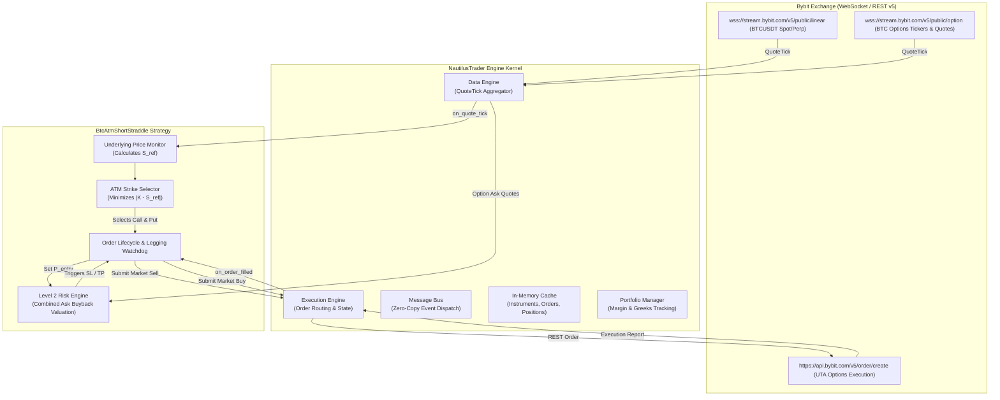

# BTC Options ATM Short Straddle Execution Engine

> **Engineering Take-Home Challenge — Trading Systems & Algorithmic Infrastructure**  
> **Candidate:** Anand Choubey (ABES Engineering College, Class of 2027)  
> **Company:** Memplus Technologies LLP (Jodhpur)  
> **Framework:** [NautilusTrader](https://nautilustrader.io/) (High-performance event-driven algorithmic trading engine)  
> **Exchange Adapter:** Bybit v5 (Unified Trading Account — Crypto Options & Linear Perpetuals)

---

## 1. Executive Summary

This repository contains a production-ready, event-driven trading strategy built on **NautilusTrader** designed to execute and manage a **BTC At-The-Money (ATM) Short Straddle** on Bybit Options.

### Scope & Levels
* **Level 1 (Naked Straddle Execution):**
  - Subscribes to real-time underlying BTC spot/perp market data.
  - Automatically queries the instrument cache, matches common Call/Put expiration cycles, and determines the nearest ATM strike ($K_{ATM} = \arg\min |K - S_t|$).
  - Submits concurrent market sell orders for both Call and Put legs.
  - Tracks the entire order lifecycle (`Submitted` $\to$ `Accepted` $\to$ `Filled`) and monitors resulting portfolio positions.
* **Level 2 (Automated Risk Management Engine):**
  - Continuous valuation of the combined buyback liability using **ask-side order book quotes**:
    $$P_{\text{buyback}}(t) = \text{Ask}_{\text{call}}(t) + \text{Ask}_{\text{put}}(t)$$
  - **Stop-Loss (+1%):** If $P_{\text{buyback}}(t) \ge P_{\text{entry}} \times 1.01$, immediately submits market buy orders to close both legs, capping downside tail risk.
  - **Take-Profit (-2%):** If $P_{\text{buyback}}(t) \le P_{\text{entry}} \times 0.98$, immediately captures theta decay / volatility contraction by buying back both legs.
  - **Legging Risk Watchdog:** Protects against asymmetric fills or venue rejections by automatically unwinding single-leg exposure if the paired leg is rejected or unacknowledged within a configurable timeout.
  - **Idempotency & Concurrency Guards:** Prevents duplicate exit submissions across high-frequency tick bursts.

---

## 2. System Architecture



---

## 3. Project Structure

```text
memplus-btc-straddle/
│
├── config.py              # Typed strategy configuration schema (BtcAtmStraddleConfig)
├── strategy.py            # Core strategy state machine, order execution & Level 2 risk engine
├── run_live_bybit.py      # TradingNode harness connecting to Bybit Testnet / Mainnet
├── run_simulation.py      # Standalone verification suite (SL, TP, Legging scenarios)
├── requirements.txt       # Project dependencies
├── .env.example           # Bybit API credentials configuration template
└── README.md              # Engineering documentation & interview walkthrough guide
```

---

## 4. Getting Started

### Prerequisites
* Python 3.11 or 3.12 (64-bit)
* Pip & Virtualenv
* (Optional for live trading) A Bybit Testnet or Mainnet account with **Unified Trading Account (UTA)** enabled.

### Installation

```bash
# 1. Clone repository & navigate to directory
cd memplus-btc-straddle

# 2. Create virtual environment
python -m venv venv
# On Windows:
.\venv\Scripts\activate
# On Linux/macOS:
source venv/bin/activate

# 3. Install dependencies
pip install -r requirements.txt
```

---

## 5. Execution Modes

### Execution Modes

#### 1. Deterministic Strategy & Risk Engine Verification
Runs a deterministic execution harness verifying the complete state machine, ATM strike selection, Level 2 Stop-Loss (+1%), Take-Profit (-2%), and legging-risk recovery:

```bash
# Run all scenarios (Stop-Loss, Take-Profit, Legging Risk Recovery)
python run_simulation.py --scenario all

# Or run individual verification scenarios:
python run_simulation.py --scenario sl       # Verifies +1% Stop-Loss execution
python run_simulation.py --scenario tp       # Verifies -2% Take-Profit execution
python run_simulation.py --scenario legging  # Verifies emergency leg unwinding
```

#### 2. Live Bybit Testnet / Mainnet Runner
Connects NautilusTrader's `TradingNode` to live Bybit WebSocket streams and routes orders through Bybit v5 UTA REST endpoints:
```bash
# Configure .env with your Bybit API keys first
cp .env.example .env

# Run Level 2 Managed Straddle on Bybit Testnet
python run_live_bybit.py --level 2 --testnet --trade-size 0.01

# Run Level 1 Naked Straddle on Bybit Testnet
python run_live_bybit.py --level 1 --testnet --trade-size 0.01
```

To run against Bybit's live or testnet options feeds:

1. Copy `.env.example` to `.env` and configure your API credentials:
   ```bash
   cp .env.example .env
   ```
2. Run the trading node:
   ```bash
   # Run Level 2 Managed Straddle on Bybit Testnet
   python run_live_bybit.py --level 2 --testnet --trade-size 0.01

   # Run Level 1 Naked Straddle on Bybit Testnet
   python run_live_bybit.py --level 1 --testnet --trade-size 0.01
   ```

---

## 6. The 10 Technical Walkthrough Questions & Answers

The engineering team evaluates candidates on these 10 core questions during the technical interview. Here is how this architecture answers each:

### 1. How does NautilusTrader start and initialize?
* **Answer:** Initialization is driven by the `TradingNode`. It reads `TradingNodeConfig`, creates the internal kernel components (`MessageBus`, `DataEngine`, `ExecutionEngine`, `Portfolio`, and in-memory `Cache`), registers venue clients (`BybitDataClient` and `BybitExecClient`), and links the strategy. When `node.build()` and `node.start()` are called, the adapters initialize WebSocket feeds, authenticate private channels, sync the instrument provider database, and trigger the strategy's `on_start()` lifecycle hook.

### 2. How have you configured the Bybit integration?
* **Answer:** Bybit v5 separates product lines. In `run_live_bybit.py`:
  - `BybitDataClientConfig` specifies `product_types=[BybitProductType.OPTION, BybitProductType.LINEAR]` and `environment=BybitEnvironment.TESTNET`. This loads both crypto options and linear perpetual reference tickers.
  - `BybitExecClientConfig` specifies `product_types=[BybitProductType.OPTION]` and `account_type=BybitAccountType.UNIFIED`, which is required because Bybit processes options exclusively under Unified Trading Accounts.

### 3. How does NautilusTrader receive market data?
* **Answer:** `BybitDataClient` establishes asynchronous WebSocket connections to Bybit's public topics (`tickers.BTC`, `orderbook.50.BTC-***`). Incoming JSON frames are parsed at high speed into strongly typed `QuoteTick` or `OrderBookDelta` objects, published to the internal `MessageBus`, and routed zero-copy to the strategy's `on_quote_tick` / `on_order_book` callbacks.

### 4. How are BTC option instruments identified and subscribed to?
* **Answer:** During startup, `BybitInstrumentProvider` queries the Bybit REST v5 instrument specification endpoint, creating `CryptoOption` instances inside `self.cache`. In `_discover_and_select_straddle_legs()`, the strategy queries `self.cache.instruments()`, filters for contracts matching `BTC`, groups available Call (`OptionKind.CALL`) and Put (`OptionKind.PUT`) contracts by expiry, and selects the strike minimizing $|K - S_{\text{spot}}|$. It then calls `self.subscribe_quote_ticks(call.id)` and `self.subscribe_quote_ticks(put.id)`.

### 5. How does the strategy receive market data events?
* **Answer:** Through NautilusTrader's event-driven handler `on_quote_tick(self, tick: QuoteTick)`. The strategy discriminates by `tick.instrument_id`:
  - If it matches `self.underlying_id`, it updates the underlying reference spot price and checks if leg selection is needed.
  - If it matches `self.call_instrument.id` or `self.put_instrument.id`, it updates `self.latest_call_ask` or `self.latest_put_ask` and triggers Level 2 risk valuation.

### 6. How are orders submitted to Bybit?
* **Answer:** The strategy uses `self.order_factory.market(...)` to generate strongly-typed `MarketOrder` objects with unique client order IDs (`ClientOrderId`), assigning `TimeInForce.IOC` (Immediate-or-Cancel). Calling `self.submit_order(order)` routes the order via the `ExecutionEngine` through `BybitExecClient`, which submits a signed HTTP POST request to Bybit's `/v5/order/create` endpoint.

### 7. How does the system know whether an order was accepted or executed?
* **Answer:** Bybit streams execution reports over private WebSocket channels (`execution` and `order` topics). The `BybitExecClient` converts these messages into Nautilus event models:
  - `OrderAccepted`: Confirms venue validation.
  - `OrderFilled`: Contains execution price (`event.last_px`) and executed volume (`event.last_qty`).
  - `OrderRejected`: Details exchange rejection codes.
  These events trigger `on_order_accepted`, `on_order_filled`, and `on_order_rejected` in the strategy.

### 8. How are positions tracked?
* **Answer:** NautilusTrader maintains real-time position state in its internal `Portfolio` and `Cache`. Each fill automatically updates the net position (`PositionOpened`, `PositionChanged`, `PositionClosed`). The strategy also locally tracks cumulative filled quantities and VWAP fill prices (`call_fill_cost / call_filled_qty`), enabling precise calculation of combined entry premium and net residual buyback obligations.

### 9. How have you implemented the Stop-Loss and Take-Profit?
* **Answer:** Evaluated continuously in `_evaluate_risk_management()` on every option quote tick:
  - **Combined Buyback Liability:** Calculated using the ask side of the order book:
    $$P_{\text{buyback}} = \text{Ask}_{\text{call}} + \text{Ask}_{\text{put}}$$
  - **Percentage Shift:**
    $$\Delta\% = \frac{P_{\text{buyback}} - P_{\text{entry}}}{P_{\text{entry}}}$$
  - If $\Delta\% \ge +0.01$ (+1%), Stop-Loss fires $\to$ market Buy orders submitted to cover both legs.
  - If $\Delta\% \le -0.02$ (-2%), Take-Profit fires $\to$ market Buy orders submitted to lock in premium decay.
  - An atomic `_exit_triggered` boolean and `StraddleState.PENDING_EXIT` guard prevent race conditions and duplicate orders.

### 10. What happens when one leg gets executed but the other leg does not? (Legging Risk)
* **Answer:** This is handled by a three-tiered protection mechanism:
  1. **Immediate Rejection Guard:** If an `OrderRejected` event is received for either leg during entry, the strategy halts and invokes `_emergency_unwind()`, immediately liquidating the filled leg.
  2. **IOC Time-In-Force:** Orders use `TimeInForce.IOC` so unfilled balances are cancelled immediately rather than lingering in the book as resting liquidity.
  3. **Execution Timeout Watchdog:** If one leg fills but the counterpart does not report a fill within `leg_fill_timeout_secs` (default: 5.0 seconds), `_handle_legging_risk()` cancels any open orders on the lagging leg and covers the filled leg using a market order, restoring portfolio delta neutrality.

---

## 7. Advanced Quantitative & Engineering Considerations

1. **Option Settlement & Margin:** Bybit crypto options are cash-settled in USDC or USDT under a Unified Trading Account (UTA). Short straddle margin requirements are dynamic and scale with portfolio Greeks, requiring portfolio-margin headroom to avoid liquidation.
2. **Execution Slippage:** Options order books often exhibit wider bid-ask spreads. Using IOC market orders guarantees fill immediacy for risk management at the cost of crossing the spread, which is why Level 2 uses the **ask price** for conservative exit valuation.
3. **Delta Drift:** An ATM straddle is delta-neutral at initiation ($\Delta_{\text{call}} \approx +0.50$, $\Delta_{\text{put}} \approx -0.50 \implies \Delta_{\text{net}} \approx 0$). As BTC trends, gamma induces directional delta exposure. The 1% stop-loss effectively caps losses from rapid gamma expansion.
